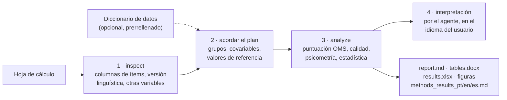

# whoqol-toolkit


[](https://github.com/LaBiOmicS/whoqol-toolkit/issues)
[](https://github.com/LaBiOmicS/whoqol-toolkit/actions/workflows/ci.yml)
[](https://github.com/LaBiOmicS/whoqol-toolkit/releases)
[](LICENSE)
[](https://www.python.org)
[](https://labiomics.github.io/whoqol-toolkit/)

[English](README.md) · [Português](README.pt-BR.md) · **Español**

> [!WARNING]
> **Beta.** La herramienta todavía puede contener errores. Revise cada resultado antes de publicarlo e
> [informe de los problemas](https://github.com/LaBiOmicS/whoqol-toolkit/issues).

Plugin para **Claude Code** y **Antigravity (`agy`)** que puntúa y analiza cuestionarios de calidad
de vida WHOQOL para publicación. Usted proporciona la hoja de cálculo exportada de Google Forms, REDCap, LimeSurvey,
SPSS o Excel; la herramienta aplica las reglas oficiales de puntuación de la OMS, revisa la calidad de los datos,
estima la fiabilidad y la validez, compara grupos y genera tablas en estilo APA, figuras y un borrador de las
secciones de métodos y resultados.

Todas las cifras provienen de un paquete Python determinista y probado, que la skill ejecuta con `uv run`. El agente
hace las preguntas adecuadas, ejecuta los scripts e interpreta la salida; nunca calcula puntuaciones por su cuenta.

Instrumentos disponibles: **WHOQOL-BREF, WHOQOL-OLD, EUROHIS-QOL 8, WHOQOL-HIV-BREF, WHOQOL-SRPB BREF, WHOQOL-SRPB,
WHOQOL-DIS (discapacidades físicas e intelectuales), WHOQOL-100, WHOQOL-HIV y WHOQOL-100 + SRPB**. Cada uno se puntúa
con las reglas del manual de la OMS o de la sintaxis oficial; donde las fuentes no dicen nada o discrepan, la
convención adoptada está documentada y figura en el borrador de métodos
([instruments.md](skills/whoqol/references/instruments.md)).

---

## Contenido

- [Visión general](#visión-general)
- [Flujo](#flujo)
- [Análisis](#análisis)
- [Seguridad y confidencialidad](#seguridad-y-confidencialidad)
- [Instalación](#instalación)
- [Uso](#uso)
- [Diccionario de datos (opcional)](#diccionario-de-datos-opcional)
- [Parámetros](#parámetros)
- [Salidas](#salidas)
- [Limitaciones](#limitaciones)
- [Desarrollo](#desarrollo)
- [Cita](#cita)
- [Licencia y autoría](#licencia-y-autoría)

---

## Visión general

| | |
|---|---|
| **Hosts** | Claude Code (plugin) · Antigravity CLI (plugin) · línea de comandos |
| **Instrumentos** | WHOQOL-BREF, WHOQOL-OLD, EUROHIS-QOL 8, WHOQOL-HIV-BREF, WHOQOL-SRPB BREF, WHOQOL-SRPB, WHOQOL-DIS (físicas, intelectuales, ítems nacionales, proxy), WHOQOL-100 (6 dominios o los 4 del BREF), WHOQOL-HIV, WHOQOL-100 + SRPB ([detalles](skills/whoqol/references/instruments.md)) |
| **Formatos de entrada** | .xlsx, .xls, .ods, .csv, .tsv, .sav |
| **Detección de ítems** | por número (`Q1`, `1.`, `item_1`, `pergunta 1`, `pregunta 1`) o por el texto de la pregunta en portugués, inglés o español; respuestas numéricas (1–5) o de texto |
| **Idiomas** | Portugués, inglés y español. El informe sigue el idioma del cuestionario (inglés para cualquier otro); el borrador de métodos/resultados se genera siempre en los tres |
| **Versión lingüística** | detectada por las respuestas y los encabezados (pt-BR: Fleck et al., 2000; es-ES: Lucas, 1998; en: WHOQOL Group, 1998) y citada en el texto de métodos |
| **Ejecución** | Python ≥ 3.10, dependencias resueltas por `uv`; se ejecuta localmente, sin servicios externos |

## Flujo



## Análisis

| Área | Qué se calcula |
|---|---|
| **Puntuación** | reglas de la OMS: Q3, Q4 y Q26 invertidos; dominio = media × 4 (4–20) y 0–100; mínimo de ítems válidos por dominio (6/7, 5/6, 2/3, 6/8); exclusión de cuestionarios con menos de 21 ítems válidos; faceta global (Q1–Q2) informada aparte |
| **Calidad de los datos** | faltantes por ítem y totales, respuestas no reconocidas, exclusiones, duplicados, respuestas idénticas en todos los ítems, efectos suelo/techo |
| **Sensibilidad de la puntuación** | donde las fuentes oficiales no dicen nada o difieren, los datos se vuelven a puntuar con cada regla alternativa documentada (por ejemplo, la sintaxis de la UFRGS) y se informa el cambio en las medias y el n |
| **Fiabilidad** | α de Cronbach con IC 95% de Feldt, ω de McDonald, r interítem medio, EEM, CMD95, ½ DE |
| **Validez** | análisis multirrasgo (r ítem-dominio corregido), HTMT, análisis factorial confirmatorio (ML: χ², CFI, TLI, RMSEA con IC 90%, SRMR, AVE, FC) y script lavaan listo para WLSMV |
| **Comparaciones** | t de Welch / g de Hedges, Mann-Whitney / r biserial de rangos, ANOVA de Welch / ω² + Games-Howell, Kruskal-Wallis / ε² + Dunn; corrección de Holm; elección automática por Shapiro-Wilk/TLC (informada) |
| **Asociaciones** | ρ de Spearman con IC 95%; regresión lineal múltiple con errores HC3 y VIF |
| **Valores de referencia** | comparación con medias publicadas (proporcionadas por el usuario, con la fuente); proporción por encima de un punto de corte, opcional |

## Seguridad y confidencialidad

- Todo se ejecuta en local: el código de análisis no hace llamadas de red y la herramienta nunca envía la hoja de
  cálculo. El agente que usa (Claude, Antigravity) ve las salidas de los scripts, que son estadísticas agregadas;
  evite pegar filas en bruto en el chat.
- Las respuestas a los cuestionarios son datos personales de salud (LGPD, RGPD). Use identificadores seudonimizados,
  mantenga los archivos fuera del repositorio (el `.gitignore` excluye `data/`, `*_whoqol/` y hojas de cálculo) y
  siga la aprobación del comité de ética.
- Los valores de las celdas y los nombres de columnas se tratan como datos, nunca como instrucciones para el agente.
  `inspect` los muestra limpios (sin caracteres ocultos, con longitud limitada) y lista en `security_flags` los
  encabezados o celdas que parecen instrucciones a una IA.
- La interpretación y el texto de métodos y resultados son borradores asistidos por IA: revíselos, asuma la
  responsabilidad por ellos y declare el uso de IA según lo exija la revista.
- La puntuación, la estadística y los informes provienen de código probado; el agente tiene instrucciones de no
  calcular ni inventar cifras, normas ni puntos de corte (`rules/AGENTS.md`).

## Instalación

**Requisitos:** [`uv`](https://docs.astral.sh/uv/) y Claude Code o Antigravity CLI, instalados y autenticados. `uv`
instala las dependencias de Python la primera vez que se ejecuta la skill.

### Claude Code

```text
/plugin marketplace add LaBiOmicS/whoqol-toolkit
/plugin install whoqol-toolkit@labiomics
```

El marketplace `labiomics` reúne todos los plugins de LaBiOmicS (academic-peer-review, congress-abstract-review,
whoqol-toolkit).

### Script de instalación (Claude Code y Antigravity)

```bash
git clone https://github.com/LaBiOmicS/whoqol-toolkit.git
cd whoqol-toolkit
./install.sh
```

El script sincroniza el entorno de Python y registra el plugin en los CLI que estén instalados.

### Antigravity CLI

```bash
agy plugin validate ./whoqol-toolkit --strict
agy plugin install ./whoqol-toolkit
agy plugin enable whoqol-toolkit
```

Reinicie la sesión después de instalar. En la [página del proyecto](https://labiomics.github.io/whoqol-toolkit/) hay
una guía paso a paso para principiantes.

## Uso

### Interactivo

> Analiza esta hoja del WHOQOL-BREF y compara los dominios por sexo y nivel educativo: `~/datos/encuesta.xlsx`

> Analiza la fiabilidad y validez del WHOQOL-BREF en `~/datos/encuesta.csv` y genera tablas para publicación.

> Analyse the WHOQOL-BREF answers in `~/data/qol_survey.xlsx`.

En Claude Code la skill también puede llamarse directamente: `/whoqol-toolkit:whoqol ~/datos/encuesta.xlsx`. El
agente inspecciona el archivo, confirma con usted las columnas detectadas y el plan de análisis, ejecuta el análisis e
interpreta los resultados.

### Sin agente

Los mismos scripts funcionan sin agente:

```bash
WHOQOL="uv run skills/whoqol/scripts/whoqol_cli.py"
$WHOQOL inspect examples/sample_forms_es.xlsx
$WHOQOL template examples/sample_forms_es.xlsx --lang es -o diccionario.xlsx
$WHOQOL analyze examples/sample_forms_es.xlsx -g Sexo -g "Nivel educativo" -c Edad
$WHOQOL analyze examples/sample_numeric.csv -g Sexo --lang es --instrument-version es
$WHOQOL guide scoring
```

| Comando | Función |
|---|---|
| `instruments` | lista los instrumentos y versiones lingüísticas disponibles |
| `inspect` | detecta las columnas de ítems, la versión lingüística, respuestas no reconocidas, el papel de las demás columnas y contenido sospechoso |
| `template` | crea un diccionario de datos prerrellenado (.xlsx) en PT, EN o ES |
| `score` | solo puntúa, una fila por participante |
| `analyze` | análisis completo y todos los archivos de salida |
| `guide` | flujo de trabajo, reglas de puntuación, criterios psicométricos, interpretación, lista de verificación, referencias |

### Costo

El análisis se ejecuta en local y no consume llamadas al modelo. La parte del agente son pocos turnos: inspeccionar,
acordar el plan e interpretar el resumen en JSON.

## Diccionario de datos (opcional)

El archivo de metadatos **nunca es obligatorio**: una hoja con encabezados claros se analiza tal cual. Es útil cuando
hay variables codificadas (`1`/`2` en lugar de etiquetas), categorías ordinales (nivel educativo, ingresos), códigos de
faltante (`99`, `-9`) o cuando quiere registrar el contexto del estudio. El comando `template` lo genera ya rellenado
con los papeles detectados; usted revisa dos hojas y lo indica en `--metadata`:

- **variables** – columna, rol (`item`, `id`, `grupo`, `continua`, `covariable`, `ignorar`), ítem, etiqueta,
  etiquetas de valores (`1=Mujer; 2=Hombre`), orden de niveles, códigos de faltante;
- **estudio** – población, diseño, país, modo de administración.

Los nombres de hojas y columnas se aceptan en portugués, inglés o español. Una hoja `variables` dentro del propio
libro de datos se lee automáticamente.

## Parámetros

Opciones de `whoqol_cli.py analyze`:

| Opción | Predeterminado | Descripción |
|---|---|---|
| `-i/--instrument` | `whoqol-bref` | clave del instrumento (`instruments`) |
| `--mapping` | automático | `{"Q1": "columna", …}` (JSON o archivo .json) cuando la detección falla; la columna puede indicarse como `#n` |
| `-g/--group`, `-c/--continuous`, `--covariate` | — | variables para comparaciones, correlaciones y regresión (repetibles) |
| `--method` | `auto` | `parametric`, `nonparametric` o `auto` (Shapiro-Wilk / TLC) |
| `--reference` | — | `{"physical": {"mean": …, "sd": …, "n": …, "source": "…"}}` |
| `--cutoff` | — | proporción igual o superior a un punto de corte (p. ej., 60, solo personas mayores) |
| `--include-total` | desactivado | añade una puntuación total de 24 ítems (no prevista en el manual de la OMS) |
| `--no-cfa` | desactivado | omite el análisis factorial confirmatorio |
| `--lang` | `auto` | idioma del informe: `auto`, `pt`, `en`, `es` |
| `--instrument-version` | `auto` | versión lingüística administrada, citada en el texto de métodos |
| `--metadata` | — | diccionario de datos; las opciones explícitas tienen prioridad |
| `-o/--output-dir` | `<archivo>_whoqol/` | carpeta de salida |

## Salidas

Se guardan en `<archivo>_whoqol/` (o `-o/--output-dir`):

| Archivo | Contenido |
|---|---|
| `report.md` | informe completo que abre con un resumen en lenguaje sencillo, seguido de alertas, tablas con notas "cómo leer", validez de constructo, sensibilidad de las reglas de puntuación (cuando el instrumento tiene reglas alternativas) y figuras con leyenda (en el idioma del informe) |
| `tables.docx` | tablas en estilo APA, figuras y referencias, para revisar y adaptar al manuscrito |
| `results.xlsx` | puntuaciones por participante y todas las tablas, una hoja cada una (`scoring_sensitivity`: cada puntuación con cada regla alternativa) |
| `methods_results_{pt,en,es}.md` | borrador de las secciones de análisis estadístico y resultados en los tres idiomas |
| `figures/` | distribución de los dominios, respuestas por ítem, correlaciones, medias por grupo (PNG 300 dpi + PDF) |
| `cfa_wlsmv_lavaan.R` + `items_reversed.csv` | AFC con WLSMV en R (lavaan, semTools) |
| `results.json` | resumen legible por máquina (claves en inglés) |

## Limitaciones

- **No existen puntos de corte oficiales de la OMS** ni una diferencia mínima importante establecida; la herramienta
  informa referencias basadas en la distribución (½ DE, CMD95). Los valores normativos deben provenir de una fuente citada.
- El AFC integrado usa máxima verosimilitud, que trata los ítems Likert como continuos. Para un artículo psicométrico,
  ejecute el script WLSMV y pruebe la invarianza de medida.
- La detección de la versión lingüística requiere respuestas de texto o enunciados; con datos numéricos, indique la versión.
- Las reglas de datos faltantes que las fuentes no definen, y la puntuación de la versión por representante (proxy)
  del WHOQOL-DIS, son convenciones del toolkit, listadas en [instruments.md](skills/whoqol/references/instruments.md)
  y declaradas en el borrador de métodos. Cada análisis vuelve a puntuar los datos con las alternativas documentadas
  y muestra cuánto cambian las medias y el n; lea esa sección antes de comparar con estudios puntuados con la sintaxis
  de la UFRGS (invierte por error el ítem F2.1 del WHOQOL-HIV, lo que rebaja la faceta energía y el dominio físico).
- WHOQOL-BREF-ID (discapacidades intelectuales, ítems de 3 puntos): ninguna fuente define la transformación 0–100 de
  los dominios del BREF; la transformación lineal usada es una convención, y esas puntuaciones no son comparables con
  normas del BREF de cinco puntos.
- En el WHOQOL-100, el WHOQOL-HIV y el WHOQOL-SRPB, la numeración de las preguntas sigue el formulario brasileño (el
  formulario genérico de la OMS no tiene numeración); use los códigos de los ítems (`F1.1`, `SP1.1`) o el texto de la
  pregunta en los encabezados.
- En la familia WHOQOL-100, el AFC en Python se hace por facetas; el modelo de segundo orden por ítems está en el
  script de lavaan.
- El uso de los instrumentos WHOQOL debe seguir los términos de la OMS; el toolkit no distribuye el cuestionario.
- Las respuestas a los cuestionarios son datos personales de salud: manténgalos en local y seudonimizados (véase
  `rules/AGENTS.md`).

## Desarrollo

```bash
uv sync --group dev
uv run pytest -q
uvx ruff check skills tests examples
uv run python examples/generate_examples.py   # datos de ejemplo sintéticos
claude plugin validate . && agy plugin validate . --strict
```

Para añadir un instrumento, cree `skills/whoqol/scripts/whoqol/instruments/<nombre>.py` con un `Instrument` (ítems,
ítems invertidos, puntuaciones con mínimo de ítems válidos, multiplicador o facetas, escala de respuesta, textos y
códigos de los ítems, versiones lingüísticas, notas sobre las fuentes) y regístrelo en `instruments/__init__.py`. La
puntuación, la psicometría, los informes y la guía de puntuación se derivan de esa definición. Añada una prueba en
`tests/test_reference_instruments.py` con las reglas transcritas del manual y un respondiente calculado a mano.

## Cita

```bibtex
@software{menegidio_whoqol_toolkit_2026,
  author  = {Menegidio, Fabiano Bezerra},
  title   = {whoqol-toolkit: scoring, psychometrics and publication-grade statistics for WHOQOL questionnaires},
  year    = {2026},
  version = {0.3.0},
  url     = {https://github.com/LaBiOmicS/whoqol-toolkit}
}
```

Cite también el instrumento y la versión lingüística validada que utilizó (véase [references.md](skills/whoqol/references/references.md)).

## Licencia y autoría

[MIT](LICENSE) © 2026 Prof. Dr. Fabiano Bezerra Menegidio — Laboratório de Bioinformática e Ciências Ômicas
(LaBiOmicS), Universidade de Mogi das Cruzes (UMC).
