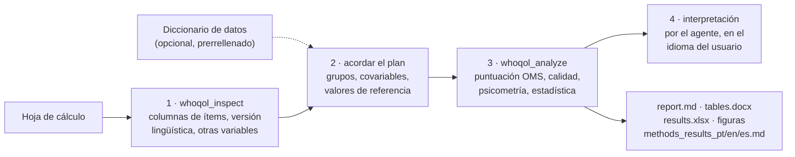

# whoqol-toolkit


[](https://github.com/LaBiOmicS/whoqol-toolkit/issues)
[](https://github.com/LaBiOmicS/whoqol-toolkit/actions/workflows/ci.yml)
[](https://github.com/LaBiOmicS/whoqol-toolkit/releases)
[](LICENSE)
[](https://www.python.org)
[](https://labiomics.github.io/whoqol-toolkit/)

[English](README.md) · [Português](README.pt-BR.md) · **Español**

> [!WARNING]
> **Beta.** La herramienta todavía puede contener errores. Revise cada resultado antes de publicarlo e
> [informe de los problemas](https://github.com/LaBiOmicS/whoqol-toolkit/issues).

Plugin para **Claude Code**, **Antigravity (`agy`)** y **Gemini CLI** que puntúa y analiza cuestionarios de calidad
de vida WHOQOL para publicación. Usted proporciona la hoja de cálculo exportada de Google Forms, REDCap, LimeSurvey,
SPSS o Excel; la herramienta aplica las reglas oficiales de puntuación de la OMS, revisa la calidad de los datos,
estima la fiabilidad y la validez, compara grupos y genera tablas en estilo APA, figuras y un borrador de las
secciones de métodos y resultados.

Todas las cifras provienen de un paquete Python determinista y probado, expuesto como servidor MCP. El agente hace las
preguntas adecuadas, ejecuta las herramientas e interpreta la salida; nunca calcula puntuaciones por su cuenta.

El primer instrumento es el **WHOQOL-BREF**. El paquete se organiza en torno a un registro de instrumentos, de modo
que otros instrumentos WHOQOL (WHOQOL-100, WHOQOL-OLD, WHOQOL-HIV-BREF, …) puedan añadirse sin cambiar el código de
análisis.

---

## Contenido

- [Visión general](#visión-general)
- [Flujo](#flujo)
- [Análisis](#análisis)
- [Seguridad y confidencialidad](#seguridad-y-confidencialidad)
- [Instalación](#instalación)
- [Uso](#uso)
- [Diccionario de datos (opcional)](#diccionario-de-datos-opcional)
- [Parámetros](#parámetros)
- [Salidas](#salidas)
- [Limitaciones](#limitaciones)
- [Desarrollo](#desarrollo)
- [Cita](#cita)
- [Licencia y autoría](#licencia-y-autoría)

---

## Visión general

| | |
|---|---|
| **Hosts** | Claude Code (plugin + MCP) · Antigravity CLI (plugin + MCP) · Gemini CLI (extensión + MCP) · línea de comandos |
| **Instrumentos** | WHOQOL-BREF (26 ítems, 4 dominios + faceta global) |
| **Formatos de entrada** | .xlsx, .xls, .ods, .csv, .tsv, .sav |
| **Detección de ítems** | por número (`Q1`, `1.`, `item_1`, `pergunta 1`, `pregunta 1`) o por el texto de la pregunta en portugués, inglés o español; respuestas numéricas (1–5) o de texto |
| **Idiomas** | Portugués, inglés y español. El informe sigue el idioma del cuestionario (inglés para cualquier otro); el borrador de métodos/resultados se genera siempre en los tres |
| **Versión lingüística** | detectada por las respuestas y los encabezados (pt-BR: Fleck et al., 2000; es-ES: Lucas, 1998; en: WHOQOL Group, 1998) y citada en el texto de métodos |
| **Ejecución** | Python ≥ 3.10, dependencias resueltas por `uv`; se ejecuta localmente, sin servicios externos |

## Flujo



## Análisis

| Área | Qué se calcula |
|---|---|
| **Puntuación** | reglas de la OMS: Q3, Q4 y Q26 invertidos; dominio = media × 4 (4–20) y 0–100; mínimo de ítems válidos por dominio (6/7, 5/6, 2/3, 6/8); exclusión de cuestionarios con menos de 21 ítems válidos; faceta global (Q1–Q2) informada aparte |
| **Calidad de los datos** | faltantes por ítem y totales, respuestas no reconocidas, exclusiones, duplicados, respuestas idénticas en todos los ítems, efectos suelo/techo |
| **Fiabilidad** | α de Cronbach con IC 95% de Feldt, ω de McDonald, r interítem medio, EEM, CMD95, ½ DE |
| **Validez** | análisis multirrasgo (r ítem-dominio corregido), HTMT, análisis factorial confirmatorio (ML: χ², CFI, TLI, RMSEA con IC 90%, SRMR, AVE, FC) y script lavaan listo para WLSMV |
| **Comparaciones** | t de Welch / g de Hedges, Mann-Whitney / r biserial de rangos, ANOVA de Welch / ω² + Games-Howell, Kruskal-Wallis / ε² + Dunn; corrección de Holm; elección automática por Shapiro-Wilk/TLC (informada) |
| **Asociaciones** | ρ de Spearman con IC 95%; regresión lineal múltiple con errores HC3 y VIF |
| **Valores de referencia** | comparación con medias publicadas (proporcionadas por el usuario, con la fuente); proporción por encima de un punto de corte, opcional |

## Seguridad y confidencialidad

- Todo se ejecuta en local: el código de análisis no hace llamadas de red y la herramienta nunca envía la hoja de
  cálculo. El agente que usa (Claude, Gemini) ve las salidas de las herramientas, que son estadísticas agregadas;
  evite pegar filas en bruto en el chat.
- Las respuestas a los cuestionarios son datos personales de salud (LGPD, RGPD). Use identificadores seudonimizados,
  mantenga los archivos fuera del repositorio (el `.gitignore` excluye `data/`, `*_whoqol/` y hojas de cálculo) y
  siga la aprobación del comité de ética.
- Los valores de las celdas y los nombres de columnas se tratan como datos, nunca como instrucciones para el agente.
- La puntuación, la estadística y los informes provienen de código probado; el agente tiene instrucciones de no
  calcular ni inventar cifras, normas ni puntos de corte (`rules/AGENTS.md`).

## Instalación

Requisitos: [`uv`](https://docs.astral.sh/uv/) y al menos uno de los CLI.

```bash
git clone https://github.com/LaBiOmicS/whoqol-toolkit.git
cd whoqol-toolkit
./install.sh
```

`install.sh` sincroniza el entorno Python, instala y valida el plugin en Antigravity (`agy`) y lo registra en Claude
Code mediante el marketplace local `labiomics-whoqol`.

**Claude Code**, directamente desde GitHub:

```
/plugin install whoqol-toolkit --marketplace LaBiOmicS/whoqol-toolkit
```

o, en versiones anteriores:

```
/plugin marketplace add LaBiOmicS/whoqol-toolkit
/plugin install whoqol-toolkit@labiomics-whoqol
```

**Antigravity:** `agy plugin install /ruta/a/whoqol-toolkit && agy plugin enable whoqol-toolkit`

**Gemini CLI:** `gemini extensions install https://github.com/LaBiOmicS/whoqol-toolkit`

## Uso

Pida en cualquiera de los tres idiomas o use el comando `/whoqol`:

```
/whoqol ~/datos/encuesta.xlsx compara los dominios por sexo y nivel educativo
Analiza esta hoja del WHOQOL-BREF y genera tablas para publicación: ~/datos/whoqol.xlsx
Evalúa la fiabilidad y la validez del WHOQOL-BREF en ~/datos/encuesta.csv
```

El agente inspecciona el archivo, confirma con usted las columnas detectadas y el plan de análisis, ejecuta el análisis
e interpreta los resultados. Sin agente, use la línea de comandos:

```bash
uv run whoqol inspect examples/sample_forms_es.xlsx
uv run whoqol analyze examples/sample_forms_es.xlsx -g Sexo -g "Nivel educativo" -c Edad
uv run whoqol analyze examples/sample_numeric.csv -g Sexo --lang es --instrument-version es
uv run whoqol guide interpretation
```

### Herramientas MCP

| Herramienta | Función |
|---|---|
| `whoqol_instruments` | lista los instrumentos y versiones lingüísticas disponibles |
| `whoqol_inspect` | detecta las columnas de ítems, la versión lingüística, respuestas no reconocidas y el papel de las demás columnas |
| `whoqol_template` | crea un diccionario de datos prerrellenado (.xlsx) en PT, EN o ES |
| `whoqol_score` | solo puntúa, una fila por participante |
| `whoqol_analyze` | análisis completo y todos los archivos de salida |
| `whoqol_guide` | flujo de trabajo, reglas de puntuación, criterios psicométricos, interpretación, lista de verificación, referencias |

## Diccionario de datos (opcional)

El archivo de metadatos **nunca es obligatorio**: una hoja con encabezados claros se analiza tal cual. Es útil cuando
hay variables codificadas (`1`/`2` en lugar de etiquetas), categorías ordinales (nivel educativo, ingresos), códigos de
faltante (`99`, `-9`) o cuando quiere registrar el contexto del estudio. `whoqol_template` lo genera ya rellenado con
los papeles detectados; usted revisa dos hojas y lo indica en `metadata=`:

- **variables** – columna, rol (`item`, `id`, `grupo`, `continua`, `covariable`, `ignorar`), ítem, etiqueta,
  etiquetas de valores (`1=Mujer; 2=Hombre`), orden de niveles, códigos de faltante;
- **estudio** – población, diseño, país, modo de administración.

Los nombres de hojas y columnas se aceptan en portugués, inglés o español. Una hoja `variables` dentro del propio
libro de datos se lee automáticamente.

## Parámetros

| Parámetro | Predeterminado | Descripción |
|---|---|---|
| `instrument` | `whoqol-bref` | clave del instrumento (`whoqol_instruments`) |
| `mapping` | automático | `{"Q1": "columna", …}` cuando la detección falla |
| `group_vars`, `continuous_vars`, `covariates` | — | variables para comparaciones, correlaciones y regresión |
| `method` | `auto` | `parametric`, `nonparametric` o `auto` (Shapiro-Wilk / TLC) |
| `reference` | — | `{"physical": {"mean": …, "sd": …, "n": …, "source": "…"}}` |
| `cutoff` | — | proporción igual o superior a un punto de corte (p. ej., 60, solo personas mayores) |
| `include_total` | `false` | añade una puntuación total de 24 ítems (no prevista en el manual de la OMS) |
| `run_cfa` | `true` | análisis factorial confirmatorio |
| `lang` | `auto` | idioma del informe: `auto`, `pt`, `en`, `es` |
| `instrument_version` | `auto` | versión lingüística administrada, citada en el texto de métodos |
| `metadata` | — | diccionario de datos; los argumentos explícitos tienen prioridad |

## Salidas

Se guardan en `<archivo>_whoqol/` (u `output_dir`):

| Archivo | Contenido |
|---|---|
| `report.md` | informe completo con alertas, tablas y figuras (en el idioma del informe) |
| `tables.docx` | tablas en estilo APA, figuras y referencias, listas para el manuscrito |
| `results.xlsx` | puntuaciones por participante y todas las tablas, una hoja cada una |
| `methods_results_{pt,en,es}.md` | borrador de las secciones de análisis estadístico y resultados en los tres idiomas |
| `figures/` | distribución de los dominios, respuestas por ítem, correlaciones, medias por grupo (PNG 300 dpi + PDF) |
| `cfa_wlsmv_lavaan.R` + `items_reversed.csv` | AFC con WLSMV en R (lavaan, semTools) |
| `results.json` | resumen legible por máquina (claves en inglés) |

## Limitaciones

- **No existen puntos de corte oficiales de la OMS** ni una diferencia mínima importante establecida; la herramienta
  informa referencias basadas en la distribución (½ DE, CMD95). Los valores normativos deben provenir de una fuente citada.
- El AFC integrado usa máxima verosimilitud, que trata los ítems Likert como continuos. Para un artículo psicométrico,
  ejecute el script WLSMV y pruebe la invarianza de medida.
- La detección de la versión lingüística requiere respuestas de texto o enunciados; con datos numéricos, indique la versión.
- Por ahora solo está implementado el WHOQOL-BREF.
- El uso de los instrumentos WHOQOL debe seguir los términos de la OMS; el toolkit no distribuye el cuestionario.
- Las respuestas a los cuestionarios son datos personales de salud: manténgalos en local y seudonimizados (véase
  `rules/AGENTS.md`).

## Desarrollo

```bash
uv sync --group dev
uv run pytest -q
uvx ruff check src tests examples
uv run python examples/generate_examples.py   # datos de ejemplo sintéticos
claude plugin validate . && agy plugin validate . --strict
```

Para añadir un instrumento, cree `src/whoqol/instruments/<nombre>.py` con un `Instrument` (ítems, ítems invertidos,
dominios con mínimo de ítems válidos, textos y patrones de los ítems en PT/EN/ES, versiones lingüísticas) y regístrelo
en `instruments/__init__.py`. La puntuación, la psicometría, los informes y la guía de puntuación se derivan de esa
definición.

## Cita

```bibtex
@software{menegidio_whoqol_toolkit_2026,
  author  = {Menegidio, Fabiano Bezerra},
  title   = {whoqol-toolkit: scoring, psychometrics and publication-grade statistics for WHOQOL questionnaires},
  year    = {2026},
  version = {0.1.0},
  url     = {https://github.com/LaBiOmicS/whoqol-toolkit}
}
```

Cite también el instrumento y la versión lingüística validada que utilizó (véase `whoqol_guide("references")`).

## Licencia y autoría

[MIT](LICENSE) © 2026 Prof. Dr. Fabiano Bezerra Menegidio — Laboratório de Bioinformática e Ciências Ômicas
(LaBiOmicS), Universidade de Mogi das Cruzes (UMC).
