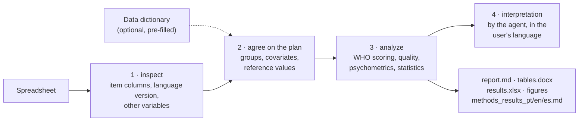

# whoqol-toolkit


[](https://github.com/LaBiOmicS/whoqol-toolkit/issues)
[](https://github.com/LaBiOmicS/whoqol-toolkit/actions/workflows/ci.yml)
[](https://github.com/LaBiOmicS/whoqol-toolkit/releases)
[](LICENSE)
[](https://www.python.org)
[](https://labiomics.github.io/whoqol-toolkit/)

**English** · [Português](README.pt-BR.md) · [Español](README.es.md)

> [!WARNING]
> **Beta.** The tool may still contain errors. Check every result before publishing it and
> [report problems](https://github.com/LaBiOmicS/whoqol-toolkit/issues).

A plugin for **Claude Code** and **Antigravity (`agy`)** that scores and analyses WHOQOL
quality-of-life questionnaires for publication. You give it the spreadsheet exported from Google Forms, REDCap,
LimeSurvey, SPSS or Excel; it applies the official WHO scoring rules, checks data quality, estimates reliability and
validity, compares groups and writes APA tables, figures and a draft of the methods and results sections.

All numbers come from a tested, deterministic Python package that the skill runs with `uv run`. The agent's job is to
ask the right questions, run the scripts and interpret the output; it never computes scores itself.

Supported instruments: **WHOQOL-BREF, WHOQOL-OLD, EUROHIS-QOL 8, WHOQOL-HIV-BREF, WHOQOL-SRPB BREF, WHOQOL-SRPB,
WHOQOL-DIS (physical and intellectual disabilities), WHOQOL-100, WHOQOL-HIV and WHOQOL-100 + SRPB**. Each one is
scored by the rules of its WHO manual or official syntax; where the sources are silent or disagree, the convention
adopted is documented and stated in the methods draft ([instruments.md](skills/whoqol/references/instruments.md)).

---

## Contents

- [Overview](#overview)
- [Pipeline](#pipeline)
- [Analyses](#analyses)
- [Security and confidentiality](#security-and-confidentiality)
- [Installation](#installation)
- [Usage](#usage)
- [Data dictionary (optional)](#data-dictionary-optional)
- [Parameters](#parameters)
- [Outputs](#outputs)
- [Limitations](#limitations)
- [Development](#development)
- [Citation](#citation)
- [License and authorship](#license-and-authorship)

---

## Overview

| | |
|---|---|
| **Hosts** | Claude Code (plugin) · Antigravity CLI (plugin) · plain command line |
| **Instruments** | WHOQOL-BREF, WHOQOL-OLD, EUROHIS-QOL 8, WHOQOL-HIV-BREF, WHOQOL-SRPB BREF, WHOQOL-SRPB, WHOQOL-DIS (PD, ID, Brazilian national items, proxy), WHOQOL-100 (6 domains or the 4 BREF domains), WHOQOL-HIV, WHOQOL-100 + SRPB ([details](skills/whoqol/references/instruments.md)) |
| **Input formats** | .xlsx, .xls, .ods, .csv, .tsv, .sav |
| **Item detection** | by number (`Q1`, `1.`, `item_1`, `pergunta 1`, `pregunta 1`) or by the question text in Portuguese, English or Spanish; numeric (1–5) or text answers |
| **Languages** | Portuguese, English and Spanish. The report follows the language of the questionnaire (English for any other); the methods/results draft is always written in all three |
| **Language version** | detected from answers and headers (pt-BR: Fleck et al., 2000; es-ES: Lucas, 1998; en: WHOQOL Group, 1998) and cited in the methods text |
| **Runtime** | Python ≥ 3.10, dependencies resolved by `uv`; runs locally, no external services |

## Pipeline



## Analyses

| Area | What is computed |
|---|---|
| **Scoring** | WHO rules: Q3, Q4 and Q26 reversed; domain = mean × 4 (4–20) and 0–100; minimum valid items per domain (6/7, 5/6, 2/3, 6/8); questionnaires with fewer than 21 valid items excluded; global facet (Q1–Q2) reported separately |
| **Data quality** | missingness per item and overall, unrecognised answers, exclusions, duplicates, straight-lining, floor/ceiling effects |
| **Scoring sensitivity** | where the official sources are silent or disagree, the data are rescored with each documented alternative rule (e.g. the UFRGS syntax) and the change in means and n is reported |
| **Reliability** | Cronbach's α with Feldt 95% CI, McDonald's ω, mean inter-item r, SEM, MDC95, ½ SD |
| **Validity** | multitrait scaling (corrected item–domain r), HTMT, confirmatory factor analysis (ML: χ², CFI, TLI, RMSEA with 90% CI, SRMR, AVE, CR) and a ready lavaan script for WLSMV |
| **Comparisons** | Welch t / Hedges g, Mann-Whitney / rank-biserial r, Welch ANOVA / ω² + Games-Howell, Kruskal-Wallis / ε² + Dunn; Holm correction; automatic choice by Shapiro-Wilk/CLT (reported) |
| **Associations** | Spearman ρ with 95% CI; multiple linear regression with HC3 errors and VIF |
| **Reference values** | one-sample comparison against published means (supplied by the user, with source); optional cut-off proportion |

## Security and confidentiality

- Everything runs locally: the analysis code makes no network calls and the spreadsheet is never uploaded by the tool.
  The agent you use (Claude, Antigravity) does see the script outputs, which are aggregated statistics; avoid pasting
  raw rows into the chat.
- Questionnaire answers are personal health data (LGPD, GDPR). Use pseudonymised IDs, keep the files outside the
  repository (`.gitignore` excludes `data/`, `*_whoqol/` and spreadsheets) and follow your ethics approval.
- Cell values and column names are treated as data, never as instructions to the agent. `inspect` prints them
  cleaned (hidden characters removed, length capped) and lists headers or cells that look like instructions to an AI
  in `security_flags`.
- The interpretation and the methods/results text are AI-assisted drafts: verify them, take responsibility for them
  and disclose AI use as your journal requires.
- The scoring, statistics and reports come from tested code; the agent is told never to compute or invent numbers,
  norms or cut-offs (`rules/AGENTS.md`).

## Installation

**Requirements:** [`uv`](https://docs.astral.sh/uv/) and Claude Code or Antigravity CLI, installed and authenticated.
The Python dependencies are installed by `uv` the first time the skill runs.

### Claude Code

```text
/plugin marketplace add LaBiOmicS/whoqol-toolkit
/plugin install whoqol-toolkit@labiomics
```

The `labiomics` marketplace lists all LaBiOmicS plugins (academic-peer-review, congress-abstract-review,
whoqol-toolkit).

### Installer script (Claude Code and Antigravity)

```bash
git clone https://github.com/LaBiOmicS/whoqol-toolkit.git
cd whoqol-toolkit
./install.sh
```

The script syncs the Python environment and registers the plugin in whichever CLIs are installed.

### Antigravity CLI

```bash
agy plugin validate ./whoqol-toolkit --strict
agy plugin install ./whoqol-toolkit
agy plugin enable whoqol-toolkit
```

Restart the session after installing. A step-by-step guide for beginners is on the
[project page](https://labiomics.github.io/whoqol-toolkit/).

## Usage

### Interactive

> Analyse the WHOQOL-BREF answers in `~/data/qol_survey.xlsx` and compare the domains by sex and education.

> Analise esta planilha do WHOQOL-BREF e gere tabelas para publicação: `~/dados/whoqol.xlsx`

> Analiza la fiabilidad y validez del WHOQOL-BREF en `~/datos/encuesta.csv`

In Claude Code the skill can also be called directly: `/whoqol-toolkit:whoqol ~/data/qol_survey.xlsx`. The agent
inspects the file, confirms the detected columns and the analysis plan with you, runs the analysis and interprets
the results.

### Headless

The same scripts run without an agent:

```bash
WHOQOL="uv run skills/whoqol/scripts/whoqol_cli.py"
$WHOQOL inspect examples/sample_google_forms_pt.xlsx
$WHOQOL template examples/sample_google_forms_pt.xlsx --lang en -o dictionary.xlsx
$WHOQOL analyze examples/sample_google_forms_pt.xlsx -g Sexo -g Escolaridade -c Idade
$WHOQOL analyze examples/sample_numeric.csv -g Sexo --lang en --instrument-version pt
$WHOQOL guide scoring
```

| Command | Purpose |
|---|---|
| `instruments` | list supported instruments and language versions |
| `inspect` | detect item columns, language version, unrecognised answers, roles of the other columns and suspicious content |
| `template` | create a pre-filled data dictionary (.xlsx) in PT, EN or ES |
| `score` | score only, one row per participant |
| `analyze` | full analysis and all output files |
| `guide` | workflow, scoring rules, psychometric criteria, interpretation, reporting checklist, references |

### Cost

The analysis runs locally and costs no model calls. The agent's part is a few turns: inspecting, agreeing on the
plan and interpreting the JSON summary.

## Data dictionary (optional)

A metadata file is **never required**: a spreadsheet with clear headers is analysed as it is. It helps when the data
has coded variables (`1`/`2` instead of labels), ordinal categories (education, income), missing codes (`99`, `-9`)
or when you want to record the study context. The `template` command writes it pre-filled with the detected roles;
you review two sheets and pass it back with `--metadata`:

- **variables** – column, role (`item`, `id`, `group`, `continuous`, `covariate`, `ignore`), item, label, value
  labels (`1=Female; 2=Male`), level order, missing codes;
- **study** – population, design, country, administration mode.

Sheet and column names are accepted in Portuguese, English or Spanish. A `variables`/`variaveis` sheet inside the data
workbook is read automatically.

## Parameters

Options of `whoqol_cli.py analyze`:

| Option | Default | Description |
|---|---|---|
| `-i/--instrument` | `whoqol-bref` | instrument key (`instruments`) |
| `--mapping` | auto | `{"Q1": "column", …}` (JSON or .json file) when detection fails; a column may be given as `#n` |
| `-g/--group`, `-c/--continuous`, `--covariate` | — | variables for comparisons, correlations and regression (repeatable) |
| `--method` | `auto` | `parametric`, `nonparametric` or `auto` (Shapiro-Wilk / CLT) |
| `--reference` | — | `{"physical": {"mean": …, "sd": …, "n": …, "source": "…"}}` |
| `--cutoff` | — | proportion at or above a cut-off (e.g. 60, older adults only) |
| `--include-total` | off | adds a 24-item total score (not part of the WHO manual) |
| `--no-cfa` | off | skips the confirmatory factor analysis |
| `--lang` | `auto` | report language: `auto`, `pt`, `en`, `es` |
| `--instrument-version` | `auto` | language version administered, cited in the methods text |
| `--metadata` | — | data dictionary; explicit options take precedence |
| `-o/--output-dir` | `<file>_whoqol/` | output folder |

## Outputs

Written to `<file>_whoqol/` (or `-o/--output-dir`):

| File | Content |
|---|---|
| `report.md` | full report with alerts, tables, scoring-rule sensitivity and figures (report language) |
| `tables.docx` | APA-style tables, figures and references, ready for the manuscript |
| `results.xlsx` | scores per participant and every table, one sheet each (`scoring_sensitivity`: every score under each alternative rule) |
| `methods_results_{pt,en,es}.md` | draft of the statistical-analysis and results sections in three languages |
| `figures/` | domain distribution, item responses, correlations, group means (PNG 300 dpi + PDF) |
| `cfa_wlsmv_lavaan.R` + `items_reversed.csv` | CFA with WLSMV in R (lavaan, semTools) |
| `results.json` | machine-readable summary (English keys) |

## Limitations

- There are **no official WHO cut-offs** and no established minimal important difference; the tool reports
  distribution-based benchmarks (½ SD, MDC95). Normative values must come from a cited source.
- The built-in CFA uses maximum likelihood, which treats Likert items as continuous. For a psychometric paper, run the
  WLSMV script and test measurement invariance.
- Language-version detection needs text answers or question headers; with numeric data, state the version.
- Missing-data rules that the sources do not give, and the scoring of the WHOQOL-DIS proxy form, are toolkit
  conventions, listed in [instruments.md](skills/whoqol/references/instruments.md) and stated in the methods draft.
  Every analysis rescores the data with the documented alternatives and reports how much means and n change; read
  that section before comparing with studies scored with the UFRGS syntax (it reverses item F2.1 of the WHOQOL-HIV by
  mistake, which lowers the energy facet and the physical domain).
- WHOQOL-BREF-ID (intellectual disabilities, 3-point items): no source gives a 0–100 rule for the BREF domains; the
  linear transformation used is a convention, and these scores are not comparable with five-point BREF norms.
- For the WHOQOL-100, WHOQOL-HIV and WHOQOL-SRPB, question numbers follow the Brazilian form (the WHO generic form
  has none); use item codes (`F1.1`, `SP1.1`) or the question text as headers.
- On the WHOQOL-100 family the Python CFA is facet-level; the item-level second-order model is in the lavaan script.
- Use of WHOQOL instruments must follow the WHO's terms; the toolkit does not distribute the questionnaire.
- Questionnaire answers are personal health data: keep them local and pseudonymised (see `rules/AGENTS.md`).

## Development

```bash
uv sync --group dev
uv run pytest -q
uvx ruff check skills tests examples
uv run python examples/generate_examples.py   # synthetic example data
claude plugin validate . && agy plugin validate . --strict
```

To add an instrument, create `skills/whoqol/scripts/whoqol/instruments/<name>.py` with an `Instrument` (items, reversed
items, scores with their minimum valid items, multiplier or facets, response scale, item texts and codes, language
versions, notes on the sources) and register it in `instruments/__init__.py`. Scoring, psychometrics, reports and the
scoring guide follow from that definition. Add a test to `tests/test_reference_instruments.py` with the rules
transcribed from the manual and a respondent calculated by hand.

## Citation

```bibtex
@software{menegidio_whoqol_toolkit_2026,
  author  = {Menegidio, Fabiano Bezerra},
  title   = {whoqol-toolkit: scoring, psychometrics and publication-grade statistics for WHOQOL questionnaires},
  year    = {2026},
  version = {0.3.0},
  url     = {https://github.com/LaBiOmicS/whoqol-toolkit}
}
```

Also cite the instrument and the validated language version you used (see [references.md](skills/whoqol/references/references.md)).

## License and authorship

[MIT](LICENSE) © 2026 Prof. Dr. Fabiano Bezerra Menegidio — Laboratório de Bioinformática e Ciências Ômicas
(LaBiOmicS), Universidade de Mogi das Cruzes (UMC).
