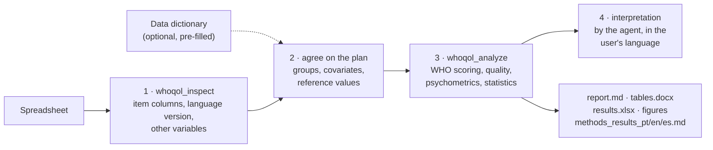

# whoqol-toolkit


[](https://github.com/LaBiOmicS/whoqol-toolkit/issues)
[](https://github.com/LaBiOmicS/whoqol-toolkit/actions/workflows/ci.yml)
[](https://github.com/LaBiOmicS/whoqol-toolkit/releases)
[](LICENSE)
[](https://www.python.org)
[](https://labiomics.github.io/whoqol-toolkit/)

**English** · [Português](README.pt-BR.md) · [Español](README.es.md)

> [!WARNING]
> **Beta.** The tool may still contain errors. Check every result before publishing it and
> [report problems](https://github.com/LaBiOmicS/whoqol-toolkit/issues).

A plugin for **Claude Code**, **Antigravity (`agy`)** and **Gemini CLI** that scores and analyses WHOQOL
quality-of-life questionnaires for publication. You give it the spreadsheet exported from Google Forms, REDCap,
LimeSurvey, SPSS or Excel; it applies the official WHO scoring rules, checks data quality, estimates reliability and
validity, compares groups and writes APA tables, figures and a draft of the methods and results sections.

All numbers come from a tested, deterministic Python package exposed as an MCP server. The agent's job is to ask the
right questions, run the tools and interpret the output; it never computes scores itself.

The first instrument is the **WHOQOL-BREF**. The package is organised around an instrument registry so other WHOQOL
instruments (WHOQOL-100, WHOQOL-OLD, WHOQOL-HIV-BREF, …) can be added without changing the analysis code.

---

## Contents

- [Overview](#overview)
- [Pipeline](#pipeline)
- [Analyses](#analyses)
- [Security and confidentiality](#security-and-confidentiality)
- [Installation](#installation)
- [Usage](#usage)
- [Data dictionary (optional)](#data-dictionary-optional)
- [Parameters](#parameters)
- [Outputs](#outputs)
- [Limitations](#limitations)
- [Development](#development)
- [Citation](#citation)
- [License and authorship](#license-and-authorship)

---

## Overview

| | |
|---|---|
| **Hosts** | Claude Code (plugin + MCP) · Antigravity CLI (plugin + MCP) · Gemini CLI (extension + MCP) · plain CLI |
| **Instruments** | WHOQOL-BREF (26 items, 4 domains + global facet) |
| **Input formats** | .xlsx, .xls, .ods, .csv, .tsv, .sav |
| **Item detection** | by number (`Q1`, `1.`, `item_1`, `pergunta 1`, `pregunta 1`) or by the question text in Portuguese, English or Spanish; numeric (1–5) or text answers |
| **Languages** | Portuguese, English and Spanish. The report follows the language of the questionnaire (English for any other); the methods/results draft is always written in all three |
| **Language version** | detected from answers and headers (pt-BR: Fleck et al., 2000; es-ES: Lucas, 1998; en: WHOQOL Group, 1998) and cited in the methods text |
| **Runtime** | Python ≥ 3.10, dependencies resolved by `uv`; runs locally, no external services |

## Pipeline



## Analyses

| Area | What is computed |
|---|---|
| **Scoring** | WHO rules: Q3, Q4 and Q26 reversed; domain = mean × 4 (4–20) and 0–100; minimum valid items per domain (6/7, 5/6, 2/3, 6/8); questionnaires with fewer than 21 valid items excluded; global facet (Q1–Q2) reported separately |
| **Data quality** | missingness per item and overall, unrecognised answers, exclusions, duplicates, straight-lining, floor/ceiling effects |
| **Reliability** | Cronbach's α with Feldt 95% CI, McDonald's ω, mean inter-item r, SEM, MDC95, ½ SD |
| **Validity** | multitrait scaling (corrected item–domain r), HTMT, confirmatory factor analysis (ML: χ², CFI, TLI, RMSEA with 90% CI, SRMR, AVE, CR) and a ready lavaan script for WLSMV |
| **Comparisons** | Welch t / Hedges g, Mann-Whitney / rank-biserial r, Welch ANOVA / ω² + Games-Howell, Kruskal-Wallis / ε² + Dunn; Holm correction; automatic choice by Shapiro-Wilk/CLT (reported) |
| **Associations** | Spearman ρ with 95% CI; multiple linear regression with HC3 errors and VIF |
| **Reference values** | one-sample comparison against published means (supplied by the user, with source); optional cut-off proportion |

## Security and confidentiality

- Everything runs locally: the analysis code makes no network calls and the spreadsheet is never uploaded by the tool.
  The agent you use (Claude, Gemini) does see the tool outputs, which are aggregated statistics; avoid pasting raw rows
  into the chat.
- Questionnaire answers are personal health data (LGPD, GDPR). Use pseudonymised IDs, keep the files outside the
  repository (`.gitignore` excludes `data/`, `*_whoqol/` and spreadsheets) and follow your ethics approval.
- Cell values and column names are treated as data, never as instructions to the agent.
- The scoring, statistics and reports come from tested code; the agent is told never to compute or invent numbers,
  norms or cut-offs (`rules/AGENTS.md`).

## Installation

Requirements: [`uv`](https://docs.astral.sh/uv/) and at least one host CLI.

```bash
git clone https://github.com/LaBiOmicS/whoqol-toolkit.git
cd whoqol-toolkit
./install.sh
```

`install.sh` syncs the Python environment, installs and validates the plugin in Antigravity (`agy`) and registers it
in Claude Code through the local marketplace `labiomics-whoqol`.

**Claude Code**, directly from GitHub:

```
/plugin install whoqol-toolkit --marketplace LaBiOmicS/whoqol-toolkit
```

or, on older versions:

```
/plugin marketplace add LaBiOmicS/whoqol-toolkit
/plugin install whoqol-toolkit@labiomics-whoqol
```

**Antigravity:** `agy plugin install /path/to/whoqol-toolkit && agy plugin enable whoqol-toolkit`

**Gemini CLI:** `gemini extensions install https://github.com/LaBiOmicS/whoqol-toolkit`

## Usage

Ask in any of the three languages, or use the `/whoqol` command:

```
/whoqol ~/data/qol_survey.xlsx compare the domains by sex and education
Analise esta planilha do WHOQOL-BREF e gere tabelas para publicação: ~/dados/whoqol.xlsx
Analiza la fiabilidad y validez del WHOQOL-BREF en ~/datos/encuesta.csv
```

The agent inspects the file, confirms the detected columns and the analysis plan with you, runs the analysis and
interprets the results. Without an agent, use the CLI:

```bash
uv run whoqol inspect examples/sample_google_forms_pt.xlsx
uv run whoqol analyze examples/sample_google_forms_pt.xlsx -g Sexo -g Escolaridade -c Idade
uv run whoqol analyze examples/sample_numeric.csv -g Sexo --lang en --instrument-version pt
uv run whoqol guide interpretation
```

### MCP tools

| Tool | Purpose |
|---|---|
| `whoqol_instruments` | list supported instruments and language versions |
| `whoqol_inspect` | detect item columns, language version, unrecognised answers and roles of the other columns |
| `whoqol_template` | create a pre-filled data dictionary (.xlsx) in PT, EN or ES |
| `whoqol_score` | score only, one row per participant |
| `whoqol_analyze` | full analysis and all output files |
| `whoqol_guide` | workflow, scoring rules, psychometric criteria, interpretation, reporting checklist, references |

## Data dictionary (optional)

A metadata file is **never required**: a spreadsheet with clear headers is analysed as it is. It helps when the data
has coded variables (`1`/`2` instead of labels), ordinal categories (education, income), missing codes (`99`, `-9`)
or when you want to record the study context. `whoqol_template` writes it pre-filled with the detected roles; you
review two sheets and pass it back with `metadata=`:

- **variables** – column, role (`item`, `id`, `group`, `continuous`, `covariate`, `ignore`), item, label, value
  labels (`1=Female; 2=Male`), level order, missing codes;
- **study** – population, design, country, administration mode.

Sheet and column names are accepted in Portuguese, English or Spanish. A `variables`/`variaveis` sheet inside the data
workbook is read automatically.

## Parameters

| Parameter | Default | Description |
|---|---|---|
| `instrument` | `whoqol-bref` | instrument key (`whoqol_instruments`) |
| `mapping` | auto | `{"Q1": "column", …}` when detection fails |
| `group_vars`, `continuous_vars`, `covariates` | — | variables for comparisons, correlations and regression |
| `method` | `auto` | `parametric`, `nonparametric` or `auto` (Shapiro-Wilk / CLT) |
| `reference` | — | `{"physical": {"mean": …, "sd": …, "n": …, "source": "…"}}` |
| `cutoff` | — | proportion at or above a cut-off (e.g. 60, older adults only) |
| `include_total` | `false` | adds a 24-item total score (not part of the WHO manual) |
| `run_cfa` | `true` | confirmatory factor analysis |
| `lang` | `auto` | report language: `auto`, `pt`, `en`, `es` |
| `instrument_version` | `auto` | language version administered, cited in the methods text |
| `metadata` | — | data dictionary; explicit arguments take precedence |

## Outputs

Written to `<file>_whoqol/` (or `output_dir`):

| File | Content |
|---|---|
| `report.md` | full report with alerts, tables and figures (report language) |
| `tables.docx` | APA-style tables, figures and references, ready for the manuscript |
| `results.xlsx` | scores per participant and every table, one sheet each |
| `methods_results_{pt,en,es}.md` | draft of the statistical-analysis and results sections in three languages |
| `figures/` | domain distribution, item responses, correlations, group means (PNG 300 dpi + PDF) |
| `cfa_wlsmv_lavaan.R` + `items_reversed.csv` | CFA with WLSMV in R (lavaan, semTools) |
| `results.json` | machine-readable summary (English keys) |

## Limitations

- There are **no official WHO cut-offs** and no established minimal important difference; the tool reports
  distribution-based benchmarks (½ SD, MDC95). Normative values must come from a cited source.
- The built-in CFA uses maximum likelihood, which treats Likert items as continuous. For a psychometric paper, run the
  WLSMV script and test measurement invariance.
- Language-version detection needs text answers or question headers; with numeric data, state the version.
- Only the WHOQOL-BREF is implemented so far.
- Use of WHOQOL instruments must follow the WHO's terms; the toolkit does not distribute the questionnaire.
- Questionnaire answers are personal health data: keep them local and pseudonymised (see `rules/AGENTS.md`).

## Development

```bash
uv sync --group dev
uv run pytest -q
uvx ruff check src tests examples
uv run python examples/generate_examples.py   # synthetic example data
claude plugin validate . && agy plugin validate . --strict
```

To add an instrument, create `src/whoqol/instruments/<name>.py` with an `Instrument` (items, reversed items, domains
with minimum valid items, item texts and patterns in PT/EN/ES, language versions) and register it in
`instruments/__init__.py`. Scoring, psychometrics, reports and the scoring guide follow from that definition.

## Citation

```bibtex
@software{menegidio_whoqol_toolkit_2026,
  author  = {Menegidio, Fabiano Bezerra},
  title   = {whoqol-toolkit: scoring, psychometrics and publication-grade statistics for WHOQOL questionnaires},
  year    = {2026},
  version = {0.1.0},
  url     = {https://github.com/LaBiOmicS/whoqol-toolkit}
}
```

Also cite the instrument and the validated language version you used (see `whoqol_guide("references")`).

## License and authorship

[MIT](LICENSE) © 2026 Prof. Dr. Fabiano Bezerra Menegidio — Laboratório de Bioinformática e Ciências Ômicas
(LaBiOmicS), Universidade de Mogi das Cruzes (UMC).
