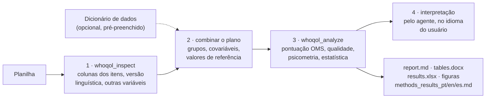

# whoqol-toolkit


[](https://github.com/LaBiOmicS/whoqol-toolkit/issues)
[](https://github.com/LaBiOmicS/whoqol-toolkit/actions/workflows/ci.yml)
[](https://github.com/LaBiOmicS/whoqol-toolkit/releases)
[](LICENSE)
[](https://www.python.org)
[](https://labiomics.github.io/whoqol-toolkit/)

[English](README.md) · **Português** · [Español](README.es.md)

> [!WARNING]
> **Beta.** A ferramenta ainda pode conter erros. Confira todo resultado antes de publicá-lo e
> [relate problemas](https://github.com/LaBiOmicS/whoqol-toolkit/issues).

Plugin para **Claude Code**, **Antigravity (`agy`)** e **Gemini CLI** que pontua e analisa questionários de qualidade
de vida WHOQOL para publicação. Você fornece a planilha exportada do Google Forms, REDCap, LimeSurvey, SPSS ou Excel;
a ferramenta aplica as regras oficiais de pontuação da OMS, verifica a qualidade dos dados, estima confiabilidade e
validade, compara grupos e gera tabelas no estilo APA, figuras e um rascunho das seções de métodos e resultados.

Todos os números vêm de um pacote Python determinístico e testado, exposto como servidor MCP. O agente faz as
perguntas certas, executa as ferramentas e interpreta a saída; nunca calcula escores por conta própria.

O primeiro instrumento é o **WHOQOL-BREF**. O pacote é organizado em torno de um registro de instrumentos, de modo
que outros instrumentos WHOQOL (WHOQOL-100, WHOQOL-OLD, WHOQOL-HIV-BREF, …) possam ser incluídos sem alterar o código
de análise.

---

## Sumário

- [Visão geral](#visão-geral)
- [Fluxo](#fluxo)
- [Análises](#análises)
- [Segurança e confidencialidade](#segurança-e-confidencialidade)
- [Instalação](#instalação)
- [Uso](#uso)
- [Dicionário de dados (opcional)](#dicionário-de-dados-opcional)
- [Parâmetros](#parâmetros)
- [Saídas](#saídas)
- [Limitações](#limitações)
- [Desenvolvimento](#desenvolvimento)
- [Citação](#citação)
- [Licença e autoria](#licença-e-autoria)

---

## Visão geral

| | |
|---|---|
| **Hosts** | Claude Code (plugin + MCP) · Antigravity CLI (plugin + MCP) · Gemini CLI (extensão + MCP) · linha de comando |
| **Instrumentos** | WHOQOL-BREF (26 itens, 4 domínios + faceta global) |
| **Formatos de entrada** | .xlsx, .xls, .ods, .csv, .tsv, .sav |
| **Detecção dos itens** | pelo número (`Q1`, `1.`, `item_1`, `pergunta 1`, `pregunta 1`) ou pelo texto da pergunta em português, inglês ou espanhol; respostas numéricas (1–5) ou em texto |
| **Idiomas** | Português, inglês e espanhol. O relatório segue o idioma do questionário (inglês para qualquer outro); o rascunho de métodos/resultados é sempre gerado nos três |
| **Versão linguística** | detectada pelas respostas e cabeçalhos (pt-BR: Fleck et al., 2000; es-ES: Lucas, 1998; en: WHOQOL Group, 1998) e citada no texto de métodos |
| **Execução** | Python ≥ 3.10, dependências resolvidas pelo `uv`; roda localmente, sem serviços externos |

## Fluxo



## Análises

| Área | O que é calculado |
|---|---|
| **Pontuação** | regras da OMS: Q3, Q4 e Q26 invertidos; domínio = média × 4 (4–20) e 0–100; mínimo de itens válidos por domínio (6/7, 5/6, 2/3, 6/8); exclusão de questionários com menos de 21 itens válidos; faceta global (Q1–Q2) relatada à parte |
| **Qualidade dos dados** | ausentes por item e no total, respostas não reconhecidas, exclusões, duplicatas, respostas idênticas em todos os itens, efeitos piso/teto |
| **Confiabilidade** | α de Cronbach com IC 95% de Feldt, ω de McDonald, r interitem médio, EPM, MMD95, ½ DP |
| **Validade** | análise multitraço (r item-domínio corrigido), HTMT, análise fatorial confirmatória (ML: χ², CFI, TLI, RMSEA com IC 90%, SRMR, AVE, CC) e script lavaan pronto para WLSMV |
| **Comparações** | t de Welch / g de Hedges, Mann-Whitney / r rank-bisserial, ANOVA de Welch / ω² + Games-Howell, Kruskal-Wallis / ε² + Dunn; correção de Holm; escolha automática por Shapiro-Wilk/TLC (relatada) |
| **Associações** | ρ de Spearman com IC 95%; regressão linear múltipla com erros HC3 e VIF |
| **Valores de referência** | comparação com médias publicadas (fornecidas pelo usuário, com a fonte); proporção acima de um ponto de corte, opcional |

## Segurança e confidencialidade

- Tudo roda localmente: o código de análise não faz chamadas de rede e a ferramenta nunca envia a planilha. O agente
  que você usa (Claude, Gemini) vê as saídas das ferramentas, que são estatísticas agregadas; evite colar linhas
  brutas no chat.
- Respostas a questionários são dados pessoais de saúde (LGPD, GDPR). Use IDs pseudonimizados, mantenha os arquivos
  fora do repositório (o `.gitignore` exclui `data/`, `*_whoqol/` e planilhas) e siga a aprovação do comitê de ética.
- Valores das células e nomes de colunas são tratados como dados, nunca como instruções ao agente.
- Pontuação, estatística e relatórios vêm de código testado; o agente é instruído a nunca calcular nem inventar
  números, normas ou pontos de corte (`rules/AGENTS.md`).

## Instalação

Requisitos: [`uv`](https://docs.astral.sh/uv/) e pelo menos um dos CLIs.

```bash
git clone https://github.com/LaBiOmicS/whoqol-toolkit.git
cd whoqol-toolkit
./install.sh
```

O `install.sh` sincroniza o ambiente Python, instala e valida o plugin no Antigravity (`agy`) e o registra no Claude
Code pelo marketplace local `labiomics-whoqol`.

**Claude Code**, direto do GitHub:

```
/plugin install whoqol-toolkit --marketplace LaBiOmicS/whoqol-toolkit
```

ou, em versões anteriores:

```
/plugin marketplace add LaBiOmicS/whoqol-toolkit
/plugin install whoqol-toolkit@labiomics-whoqol
```

**Antigravity:** `agy plugin install /caminho/para/whoqol-toolkit && agy plugin enable whoqol-toolkit`

**Gemini CLI:** `gemini extensions install https://github.com/LaBiOmicS/whoqol-toolkit`

## Uso

Peça em qualquer um dos três idiomas ou use o comando `/whoqol`:

```
/whoqol ~/dados/whoqol.xlsx compare os domínios por sexo e escolaridade
Analise esta planilha do WHOQOL-BREF e gere tabelas para publicação: ~/dados/whoqol.xlsx
Avalie a confiabilidade e a validade do WHOQOL-BREF em ~/dados/pesquisa.csv
```

O agente inspeciona o arquivo, confirma com você as colunas detectadas e o plano de análise, executa a análise e
interpreta os resultados. Sem agente, use a linha de comando:

```bash
uv run whoqol inspect examples/sample_google_forms_pt.xlsx
uv run whoqol analyze examples/sample_google_forms_pt.xlsx -g Sexo -g Escolaridade -c Idade
uv run whoqol analyze examples/sample_numeric.csv -g Sexo --lang pt --instrument-version pt
uv run whoqol guide interpretation
```

### Ferramentas MCP

| Ferramenta | Função |
|---|---|
| `whoqol_instruments` | lista os instrumentos e versões linguísticas suportados |
| `whoqol_inspect` | detecta as colunas dos itens, a versão linguística, respostas não reconhecidas e o papel das demais colunas |
| `whoqol_template` | cria um dicionário de dados pré-preenchido (.xlsx) em PT, EN ou ES |
| `whoqol_score` | apenas pontua, uma linha por participante |
| `whoqol_analyze` | análise completa e todos os arquivos de saída |
| `whoqol_guide` | fluxo de trabalho, regras de pontuação, critérios psicométricos, interpretação, checklist de relato, referências |

## Dicionário de dados (opcional)

O arquivo de metadados **nunca é obrigatório**: uma planilha com cabeçalhos claros é analisada como está. Ele ajuda
quando há variáveis codificadas (`1`/`2` em vez de rótulos), categorias ordinais (escolaridade, renda), códigos de
ausente (`99`, `-9`) ou quando você quer registrar o contexto do estudo. O `whoqol_template` gera o arquivo já
preenchido com os papéis detectados; você revisa duas abas e o informa em `metadata=`:

- **variaveis** – coluna, papel (`item`, `id`, `grupo`, `continua`, `covariavel`, `ignorar`), item, rótulo, rótulos
  dos valores (`1=Feminino; 2=Masculino`), ordem dos níveis, códigos de ausente;
- **estudo** – população, delineamento, país, modo de aplicação.

Nomes de abas e colunas são aceitos em português, inglês ou espanhol. Uma aba `variaveis`/`variables` dentro da própria
planilha de dados é lida automaticamente.

## Parâmetros

| Parâmetro | Padrão | Descrição |
|---|---|---|
| `instrument` | `whoqol-bref` | chave do instrumento (`whoqol_instruments`) |
| `mapping` | automático | `{"Q1": "coluna", …}` quando a detecção falha |
| `group_vars`, `continuous_vars`, `covariates` | — | variáveis para comparações, correlações e regressão |
| `method` | `auto` | `parametric`, `nonparametric` ou `auto` (Shapiro-Wilk / TLC) |
| `reference` | — | `{"physical": {"mean": …, "sd": …, "n": …, "source": "…"}}` |
| `cutoff` | — | proporção igual ou acima de um ponto de corte (ex.: 60, apenas idosos) |
| `include_total` | `false` | inclui um escore total de 24 itens (não previsto no manual da OMS) |
| `run_cfa` | `true` | análise fatorial confirmatória |
| `lang` | `auto` | idioma do relatório: `auto`, `pt`, `en`, `es` |
| `instrument_version` | `auto` | versão linguística aplicada, citada no texto de métodos |
| `metadata` | — | dicionário de dados; argumentos explícitos têm precedência |

## Saídas

Gravadas em `<arquivo>_whoqol/` (ou `output_dir`):

| Arquivo | Conteúdo |
|---|---|
| `report.md` | relatório completo com alertas, tabelas e figuras (no idioma do relatório) |
| `tables.docx` | tabelas no estilo APA, figuras e referências, prontas para o manuscrito |
| `results.xlsx` | escores por participante e todas as tabelas, uma aba cada |
| `methods_results_{pt,en,es}.md` | rascunho das seções de análise estatística e resultados nos três idiomas |
| `figures/` | distribuição dos domínios, respostas por item, correlações, médias por grupo (PNG 300 dpi + PDF) |
| `cfa_wlsmv_lavaan.R` + `items_reversed.csv` | AFC com WLSMV no R (lavaan, semTools) |
| `results.json` | resumo legível por máquina (chaves em inglês) |

## Limitações

- **Não existem pontos de corte oficiais da OMS** nem diferença mínima importante estabelecida; a ferramenta relata
  referências baseadas na distribuição (½ DP, MMD95). Valores normativos devem vir de uma fonte citada.
- A AFC embutida usa máxima verossimilhança, que trata itens Likert como contínuos. Para um artigo psicométrico,
  rode o script WLSMV e teste a invariância de medida.
- A detecção da versão linguística depende de respostas em texto ou dos enunciados; com dados numéricos, informe a versão.
- Por enquanto, apenas o WHOQOL-BREF está implementado.
- O uso dos instrumentos WHOQOL deve seguir os termos da OMS; o toolkit não distribui o questionário.
- Respostas a questionários são dados pessoais de saúde: mantenha-os locais e pseudonimizados (veja `rules/AGENTS.md`).

## Desenvolvimento

```bash
uv sync --group dev
uv run pytest -q
uvx ruff check src tests examples
uv run python examples/generate_examples.py   # dados de exemplo sintéticos
claude plugin validate . && agy plugin validate . --strict
```

Para incluir um instrumento, crie `src/whoqol/instruments/<nome>.py` com um `Instrument` (itens, itens invertidos,
domínios com mínimo de itens válidos, textos e padrões dos itens em PT/EN/ES, versões linguísticas) e registre-o em
`instruments/__init__.py`. Pontuação, psicometria, relatórios e o guia de pontuação decorrem dessa definição.

## Citação

```bibtex
@software{menegidio_whoqol_toolkit_2026,
  author  = {Menegidio, Fabiano Bezerra},
  title   = {whoqol-toolkit: scoring, psychometrics and publication-grade statistics for WHOQOL questionnaires},
  year    = {2026},
  version = {0.1.0},
  url     = {https://github.com/LaBiOmicS/whoqol-toolkit}
}
```

Cite também o instrumento e a versão linguística validada utilizada (veja `whoqol_guide("references")`).

## Licença e autoria

[MIT](LICENSE) © 2026 Prof. Dr. Fabiano Bezerra Menegidio — Laboratório de Bioinformática e Ciências Ômicas
(LaBiOmicS), Universidade de Mogi das Cruzes (UMC).
